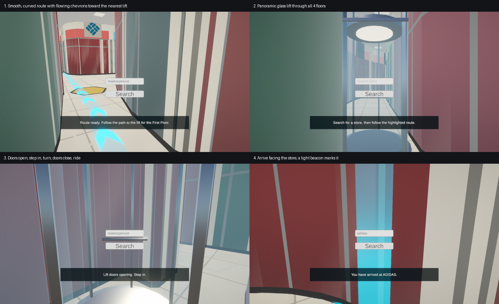
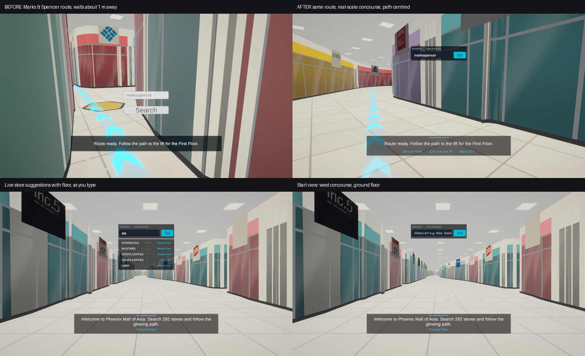
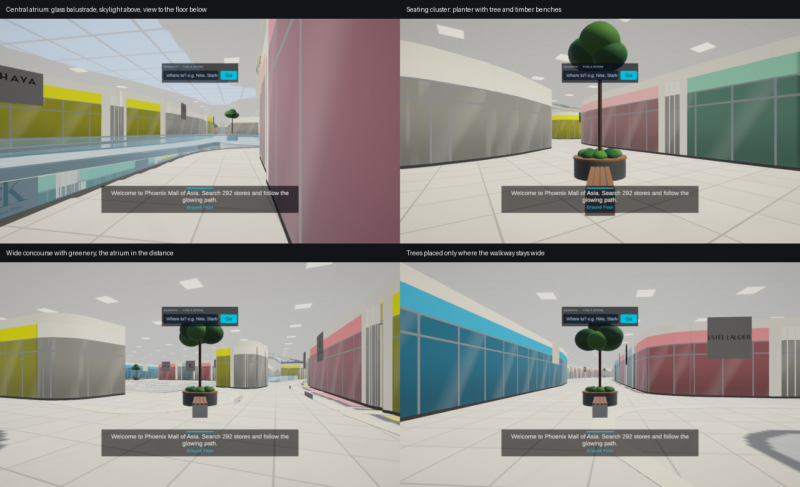
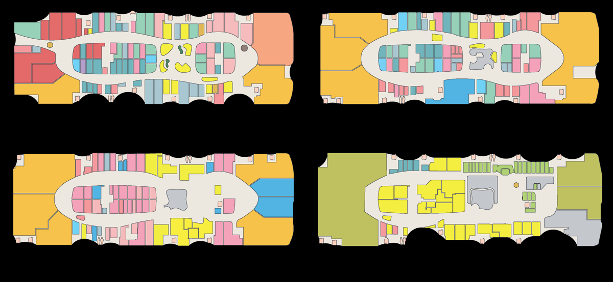

# Saarathi — VR Navigation for Phoenix Mall of Asia

**Saarathi** is a first-person virtual-reality wayfinding app for a large, multi-storey shopping mall
(Phoenix Mall of Asia, Bengaluru). You search for any of the mall's ~290 stores and a glowing guide
leads you there: along curved routes through the concourses and, when the store is on another floor,
into a panoramic glass lift and out on the right level.

It runs with an OpenXR headset, or on a normal Windows PC with keyboard and mouse.

The whole mall is reconstructed from data: official floor-plan images, scraped store information and
OCR. The heavy preprocessing is accelerated with CPU multithreading and GPU OCR, which is the "parallel
computing" half of this CGVR + PAGP course project. [`README.md`](README.md) describes the research
methodology and benchmarks. This guide covers what the app does, how it is built, and how to run and
extend it.



---

## Contents

1. [Features](#features)
2. [Quick start](#quick-start)
3. [Controls](#controls)
4. [Repository layout](#repository-layout)
5. [How it works](#how-it-works)
6. [Rebuilding the generated data](#rebuilding-the-generated-data)
7. [Building the app](#building-the-app)
8. [Automated route test](#automated-route-test)
9. [Troubleshooting](#troubleshooting)
10. [Team](#team)

---

## Features

**Finding a store**
- Search bar with **live suggestions** as you type (name, partial name or category), each showing its floor.
- A store database with 292 entries across four floors (Ground, First, Second, Third), with categories, logos and descriptions.

**Getting there**
- A* pathfinding on a 0.5 m grid per floor. Routes prefer to keep about 3 m from walls, are straightened
  with line-of-sight "string pulling", and have their corners rounded with curves.
- Smooth guided walking (2.4 m/s by default): eased acceleration, braking into the destination, slowing on
  bends, and look-ahead steering. It stops a step short of the shopfront and turns to face the store.
- **Glass lifts** run through all four floors. The nearest lift for the whole trip is chosen automatically.
  A ride is fully animated: the lift is called, the doors slide open, you step in and turn around, the doors
  close, the eased ride runs, and you step out. Floor indicators light up as the cab passes.
- The route is shown as a **flowing ribbon of chevrons** on the floor. The part you have already walked
  fades behind you.
- Light **beacons** mark the lift (gold) and the destination (cyan).
- A status card shows the current floor, metres to go and an estimated time.

**The mall**
- Real-scale footprint (about 318 m × 147 m) with 5 m storeys and wide concourses.
- Floors are colour-coded per shop from the official map. Corridors use polished stone tiles.
- Every shopfront has tinted glass, mullions, a fascia in the shop's category colour, and pillars between neighbouring units.
- Ceilings with light panels, an **open central atrium** through the first and second floors with glass
  balustrades, and skylights.
- 23 seating clusters and planters with trees, placed only where the concourse is wide enough that walkways stay generous.
- Soft bloom, filmic tone mapping, MSAA and SMAA anti-aliasing, and a light depth haze.





---

## Quick start

### Option A — run a build (Windows)

If you have a build (from a GitHub Release, or one you made with [Building the app](#building-the-app)), run:

```
Unity Files\Builds\Windows\MallOfAsia.exe
```

With an OpenXR headset runtime active (Meta Quest Link, SteamVR, Windows Mixed Reality) it starts in VR.
Otherwise it falls back to desktop controls. "OpenXR runtime unavailable" lines in the log just mean no
headset was found.

### Option B — open the project in Unity

1. Install **Unity 6000.2.8f1** (Unity 6) with *Windows Build Support*.
2. In Unity Hub, choose **Add → Add project from disk** and select the **`Unity Files`** folder. Do not
   select the repository root.
3. Open `Assets/Scenes/SampleScene.unity` and press **Play**.

The first import takes a few minutes. Unity downloads the packages listed in `Unity Files/Packages/manifest.json`
(URP 17, XR Interaction Toolkit 3, OpenXR, Input System, TextMesh Pro and others).

---

## Controls

| Action | Desktop | VR |
| --- | --- | --- |
| Search | Click the search bar, type, press **Enter** or **Go**, or click a suggestion | Point at the panel with a controller ray |
| Walk freely | **W A S D**, hold **Shift** to go faster (cancels guidance) | Thumbstick locomotion from the XR rig |
| Look around | Hold the **right mouse button** and move the mouse | Head tracking |
| Release cursor | **Esc** | — |

During guided walking you can still look up and down. Manual controls pause while you are in a lift.

---

## Repository layout

```
├── README.md                        Research write-up: methodology, parallelism, benchmarks
├── PROJECT_GUIDE.md                 This guide
├── requirements.txt                 Python packages for the data pipeline
├── docs/images/                     Screenshots used in the docs
│
├── Web Scraping Data/               Selenium scrapers for store metadata (sequential versions)
├── Parallelism/                     Multithreaded scrapers + GPU OCR benchmark notebook
├── Floor Plans Image Processing/    OpenCV floor-plan processing and the Unity data builders
│   ├── wall_bitmap.py                     wall / navigable bitmaps from the floor plans
│   ├── floor_plan_processor_v3.py         store detection
│   ├── store_names_centroids.py           OCR of store names + centroids
│   ├── build_unity_floor_textures.py      colour-coded per-floor plan textures for Unity
│   ├── build_unity_walkable_maps.py       walkable maps corrected against the real 3D walls
│   └── build_unity_decor_layout.py        atrium voids, skylights, bench/planter placement
├── Final Datasets/                  Floor maps, bitmasks, detected stores, cleaned CSVs,
│                                    and the 3D wall footprint (Wall_Mesh_Footprint/)
│
└── Unity Files/                     The Unity 6 project (open this folder in Unity)
    ├── Packages/manifest.json
    ├── ProjectSettings/
    └── Assets/
        ├── Scenes/SampleScene.unity       the only scene
        ├── Scripts/                       runtime code (see below)
        ├── Editor/                        build + scene-setup tools (menu: Tools ▸ Mall)
        ├── Shaders/                       Mall/Plan Surface, Mall/Effects
        ├── Textures/MallPlan/             generated plan textures + atrium mask
        ├── Textures/NavRefined/           generated walkable maps used by A*
        ├── Resources/                     materials and the decor layout loaded at runtime
        ├── StreamingAssets/               pheonix_mall_of_asia_stores.db (SQLite)
        ├── Final Floors with Banners/     reconstructed floor models (FBX, from Blender)
        ├── Logos/, Prefabs/, Materials/   store branding and shared assets
        └── XR/                            XR Interaction Toolkit starter assets
```

---

## How it works

### 1. Offline pipeline (Python)

```
Official floor plans ──► OpenCV (wall_bitmap.py, floor_plan_processor_v3.py)
                           │   wall bitmaps, navigable bitmaps, store outlines
                           ▼
              OCR (EasyOCR CRAFT + CRNN, GPU) ──► store names + centroids
Store websites ──► Selenium scrapers (ThreadPoolExecutor) ──► categories, logos, descriptions
                           ▼
                 SQLite: pheonix_mall_of_asia_stores.db  (Unity StreamingAssets)
                           ▼
         Blender: bitmaps extruded into 3D floor models  (FBX in Unity)
```

Three more scripts turn the same data into Unity-ready assets:

| Script | Produces | Purpose |
| --- | --- | --- |
| `build_unity_floor_textures.py` | `Textures/MallPlan/floor_<n>_plan.png` | One RGBA texture per floor. RGB is the shop's category colour (text and icons removed) and alpha is the region type (corridor / shop / outline / outside). |
| `build_unity_walkable_maps.py` | `Textures/NavRefined/floor_<n>_walkable.png` | Navigable areas limited to inside the building and kept 0.45 m away from the actual 3D walls. The original traced masks overlapped the walls by up to 0.5 m. |
| `build_unity_decor_layout.py` | `Textures/MallPlan/atrium_mask.png`, `Resources/MallDecorLayout.json` | Atrium voids where walkways stay at least 3.5 m wide, skylights, and bench/planter spots in the widest concourses. |



### 2. Coordinate system

All plan data is 3000 × 1385 px per floor. `MallWorldScale` (in `Assets/Scripts`) defines the mapping:

```
world.x = -pixelX * WorldUnitsPerPixel      WorldUnitsPerPixel = 0.02645833 * HorizontalScale (4)
world.z =  pixelY * WorldUnitsPerPixel      ≈ 0.106 m per pixel  → 318 m × 147 m footprint
world.y =  floor * 5 m
```

The footprint is scaled 4× horizontally compared with the original reconstruction. At the old scale the
corridors were only 1 to 3 m wide next to 5 m storeys, which made walking feel cramped. Heights are unchanged.

### 3. Runtime (Unity, `Assets/Scripts`)

| Component | Role |
| --- | --- |
| `DatabaseManager` | Copies the SQLite DB from StreamingAssets to the user data folder and opens it (SQLite4Unity3d). |
| `SearchStoreUI` | Search panel, live suggestions, status and HUD card. Converts store centroids into world positions and starts navigation. |
| `GridFromTexture` | Builds the per-floor A* grid from the walkable map, with a wall-clearance field and blocking of lifts and furniture. |
| `PathFinding`, `PathRequestManager`, `Heap`, `Node` | A* with a clearance penalty, string pulling and curved smoothing; queued path requests per floor. |
| `Unit` | The visitor (XR rig). Follows routes with eased motion and look-ahead steering, chooses lifts, and runs the trip legs. |
| `InterFloorController` | Activates one floor's pathfinder at a time, defines and builds the lifts, and chooses the best lift. |
| `LiftShaft` | Procedural panoramic glass lift: shaft, cab, sliding doors, floor indicators and the ride sequence. |
| `RouteGuide` | Chevron route ribbon, fading progress, and the destination and lift beacons. |
| `MallDecor` | Atrium balustrades, seating clusters and planters from `MallDecorLayout.json`; blocks them in the A* grids. |
| `PlayerMovement` | Desktop fallback controls with smoothed movement and a guided camera tilt. |
| `SmokeTestRunner` | Optional automated route test, active only with `-mallSmokeTest` (see below). |

Shaders (`Assets/Shaders`):
- **Mall/Plan Surface** draws floors, walls and ceilings from the plan textures in world space: marble
  corridors, shop-coloured floors, glass shopfronts with coloured fascias and pillars, ceiling light
  panels, atrium openings and skylights.
- **Mall/Effects** covers glass, the flowing route chevrons, beacons, floor halos and glows.

### 4. Editor automation (`Assets/Editor`, menu **Tools ▸ Mall**)

`BuildWindowsPlayer.Build` runs every setup step and then builds, so a fresh clone always produces the same result:

1. `XRProjectSetup` sets up OpenXR and the XR rig.
2. `URPMaterialFixer` converts any built-in-pipeline materials to URP. Built-in shaders render invisible in URP builds.
3. `MallScaleSetup` applies the 4× footprint scale and assigns the refined walkable maps to the grids.
4. `MallVisualSetup` sets up materials, ceilings, lighting, post-processing, camera quality, the spawn point and the decor object.
5. `WallFootprintExporter` (menu only) re-exports the 3D wall footprint used by the Python walkable-map builder.

---

## Rebuilding the generated data

Only needed if you change the floor plans, the 3D models or the placement rules. Run from the repository root:

```bash
pip install -r requirements.txt
python "Floor Plans Image Processing/build_unity_floor_textures.py"
python "Floor Plans Image Processing/build_unity_decor_layout.py"   # also rebuilds the walkable maps
```

If the 3D floor models changed, first export their wall footprint in Unity with **Tools ▸ Mall ▸ Export Wall Footprint**.

The OCR and scraping scripts need extra setup: `easyocr` (pulls in PyTorch, and a CUDA GPU is recommended),
`pytesseract` with the Tesseract binary, and `selenium` with Chrome. Their outputs are already committed
under `Final Datasets/`.

---

## Building the app

From the Unity editor: **File ▸ Build Profiles ▸ Windows ▸ Build**, or run the scripted build, which also applies all the setup steps:

```powershell
& "<Unity 6000.2.8f1>\Editor\Unity.exe" -batchmode -nographics -quit `
  -projectPath "Unity Files" -executeMethod BuildWindowsPlayer.Build -logFile build.log
```

The output is `Unity Files/Builds/Windows/MallOfAsia.exe`. Builds are ignored by git. Attach a zipped build to a GitHub Release to share it.

The Windows build uses Direct3D 11. Direct3D 12 crashed intermittently on exit on the test machine.

---

## Automated route test

The built player has a self-test that searches stores, follows each route (including lift rides), saves
screenshots and quits with exit code 0 only if every route arrives on the correct floor:

```powershell
.\MallOfAsia.exe -screen-fullscreen 0 -mallSmokeTest "marksspencer;nike;inoxmegaplex;hm;adidas" `
  -mallSmokeTestOut C:\temp\smoke -logFile C:\temp\smoke.log
Select-String C:\temp\smoke.log -Pattern "SMOKE"
```

Store names are the `normalized_name` values in the database. Other options:
- `-mallViewpoints "x,y,z,yaw;…"` captures fixed views.
- `-mallSuggestDemo "sta"` captures the suggestion list.
- Each route is also written as a CSV of points, which is handy for measuring clearance.

Latest results: all tested routes arrive on the correct floor, including multi-floor trips through both lifts.

---

## Troubleshooting

| Symptom | Fix |
| --- | --- |
| Pink or invisible materials | Run **Tools ▸ Mall ▸ Apply Mall Visuals**. The scripted build does this automatically. |
| "Store database could not be loaded" | Make sure `Assets/StreamingAssets/pheonix_mall_of_asia_stores.db` exists. Delete the copy in `%USERPROFILE%\AppData\LocalLow\DefaultCompany\Mall of Asia Navigation` to refresh it. |
| "No walkable route was found" | The store's centroid is far from any walkway. Check its centroid in the DB, or regenerate the walkable maps. |
| Starts in desktop mode with a headset connected | Set your headset's OpenXR runtime as active (Quest Link, SteamVR, …) before launching. |
| Packages fail to resolve | Open `Unity Files` (not the repo root) with Unity **6000.2.8f1**. Other versions may upgrade the packages. |

---

## Team

Krupa, Pavithra and Manasa (see [`README.md`](README.md)). Built for the Computer Graphics & Virtual
Reality (CGVR) and Parallel Architecture & GPU Programming (PAGP) courses.
